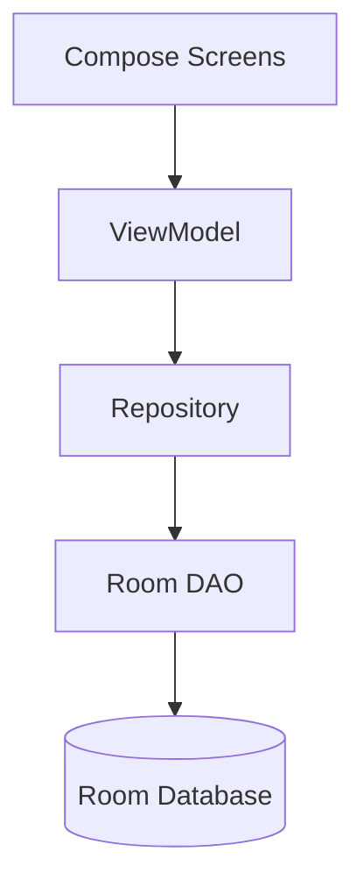

# Technical Architecture

MoneyMap is built using modern Android best practices:

- **Language**: Kotlin
- **UI Framework**: Jetpack Compose (Material Design 3)
- **Architecture**: MVVM (Model-View-ViewModel) + Repository Pattern
- **Database**: Room Persistence Library
- **Preferences**: Jetpack DataStore
- **Concurrency**: Coroutines & Flow
- **OCR**: Google ML Kit (Text Recognition)
- **Dependency Injection**: Constructor injection (manual)

## Data Flow

- **Storage**: Data is stored locally in an encrypted Room SQLite database.
- **Offline Functionality**: 100% offline-first. No network calls required for core logic.
